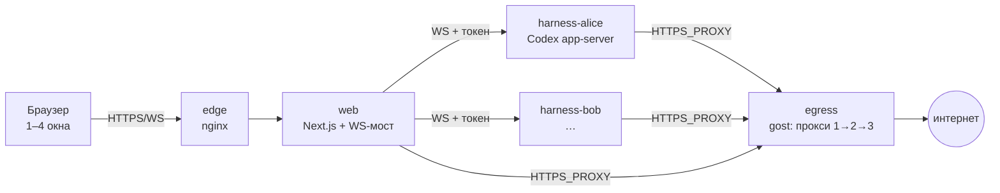

# Paddock

**Self-hosted веб-кабинет для AI-агентов: у каждого пользователя свой изолированный контейнер с харнессом (сейчас Codex), одна веб-морда — до 4 чатов на экране, как вкладки в iTerm.**

Простое решение, которое переносит в браузер привычную работу в терминале: несколько агентов
параллельно, statusline со всеми цифрами (модель, папка, контекст, кеш, лимиты), правка
сообщений, файлы, которые трогал агент, и всё это — за изоляцией и прокси.

> Скриншоты — в `docs/img/` (добавляются).

## Что умеет

- **До 4 чатов на экране**: перетаскивание окон, границы мышью, Alt+1…4, всё восстанавливается после перезагрузки.
- **Codex целиком в браузере**: стрим, markdown с подсветкой, карточки shell / правок / веб-поиска, разрешения, правка сообщения с откатом, «ответить заново».
- **Statusline** как в Claude Code: модель и усилие, папка и ветка, заполненность контекста, кеш, лимит подписки.
- **Модели**: подписка ChatGPT (вход по коду устройства прямо из морды) и любые OpenAI-совместимые провайдеры с Responses API — например [NeuralDeep](https://neuraldeep.ru/docs).
- **Картинки**: генерация и правка командой `paddock-images` (работает с любой моделью, в том числе NeuralDeep), миниатюры в чате.
- **Инструменты**: реестр CLI и скиллов в настройках, у каждого чата видно, что ему доступно и что использовано.
- **Под ответом**: модель, время, TTFT, скорость генерации (tok/s) — хранятся на сервере.
- **Изоляция**: контейнер на пользователя, `cap_drop: ALL`, выход в интернет только через цепочку прокси (gost, failover), LAN и хост закрыты.
- **Самовыкатка**: агент админа может править эту морду и выкатывать её; супервизор переключает только живую сборку и откатывает сломанную.

## Схема



Подробно: [docs/reference/architecture.md](docs/reference/architecture.md) ·
харнессы и их смена: [docs/reference/harness-protocol.md](docs/reference/harness-protocol.md) ·
план: [docs/plans/roadmap.md](docs/plans/roadmap.md).

## Быстрый старт

```bash
git clone https://github.com/vakovalskii/paddock && cd paddock
# секреты и первый пользователь — docs/ops/deploy.md
./add-user.sh alice --admin
docker compose up -d --build
docker compose exec web npm run create-user -- alice@hub.local 'long-password-here'
open http://localhost:8088
```

## Документация

База знаний по подходу [OntoShip](https://github.com/vakovalskii/ontoship) — [docs/README.md](docs/README.md).
Агентам: [AGENTS.md](AGENTS.md).

## Лицензия

MIT
