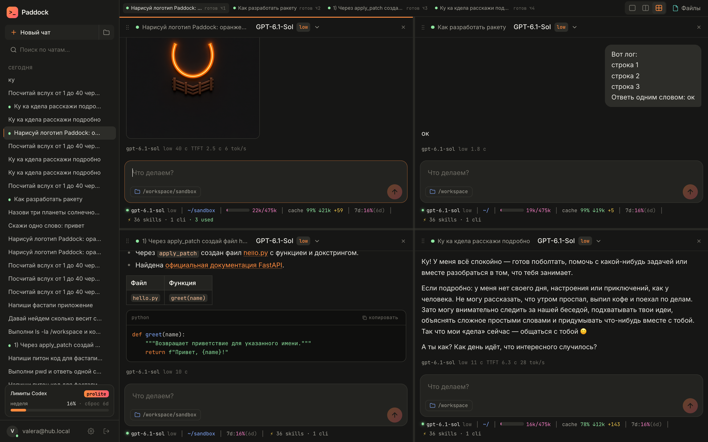
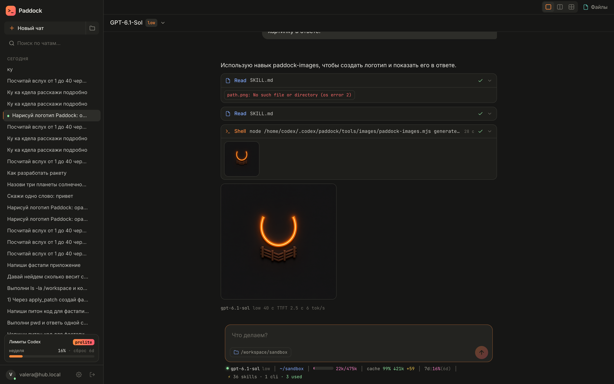
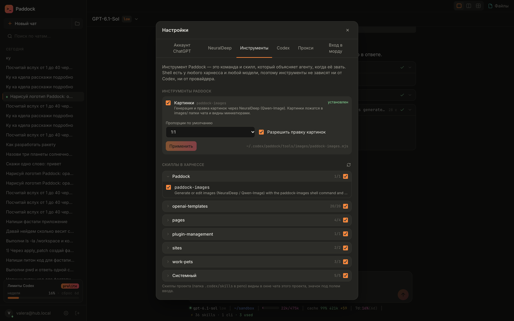
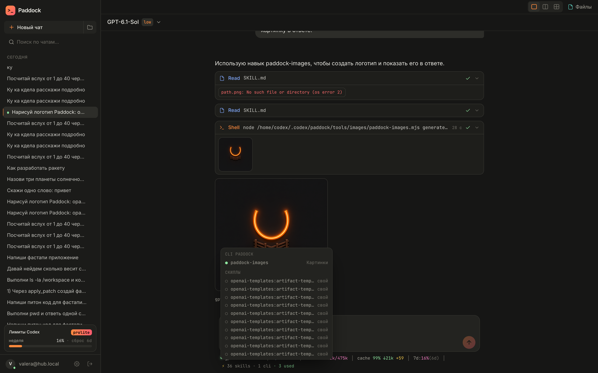
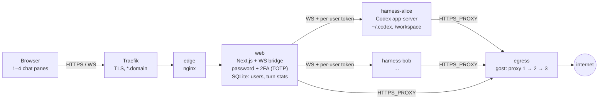

# Paddock

**A self-hosted web cockpit for AI coding agents. Every user gets their own isolated container with an agent harness; one browser UI shows up to four chats side by side, like tabs in iTerm.**

Paddock does not ship its own agent. It takes a ready-made harness (today Codex app-server, next OpenCode, Hermes and others), runs it per user behind network isolation and an egress proxy, and gives it a web UI that feels like working in a terminal: several agents in parallel, a statusline with every number that matters, quick edits, and nothing in between.



## What it does

- **Up to 4 chats on screen.** Drag panes, resize with splitters, `Alt+1…4`, layout survives reloads.
- **The whole harness in the browser.** Streaming, markdown with highlighting, cards for shell / file edits / web search, approvals, edit-and-rerun a message.
- **A statusline like Claude Code.** Model and effort, folder and branch, context fill, cache hit, subscription limits.
- **Under every answer.** Model, duration, **TTFT** and **tokens/s**, stored server-side so they survive reloads and other devices.
- **Models.** ChatGPT subscription (device-code login right from the UI) and any OpenAI-compatible provider with the Responses API, e.g. [NeuralDeep](https://neuraldeep.ru/docs).
- **Tools, harness-agnostic.** A Paddock tool is a CLI plus a skill that tells the agent when to call it. Every harness and every model has a shell, so tools work everywhere. First one: image generation and editing (`paddock-images`).
- **See what each chat can use.** Skills and CLIs available to the session, and which ones the agent actually used.
- **Isolation as a product.** A container per user, `cap_drop: ALL`, no direct internet: egress only through a gost proxy chain with failover; LAN and host are closed.
- **Login.** Password plus **2FA (TOTP)** with Authy, Google Authenticator or 1Password; trusted-browser option; backup codes.
- **Self-deploy.** An admin's agent can edit this UI and ship it; a supervisor switches the live build and rolls back a broken one.

| Image generation in a chat | Tools and skills | What this chat can use |
|---|---|---|
|  |  |  |

## How it works



- The browser never sees a harness token; the web bridge checks the session cookie and `Origin` and adds the user's token.
- Harnesses live in an `internal` Docker network: the only way out is the egress proxy, private networks are refused.
- All user state is in named volumes (`codex-home-<user>`, `workspace-<user>`), so moving to another server is copy volumes + `docker compose up`.

Details: [architecture](docs/reference/architecture.md) · [harness protocol](docs/reference/harness-protocol.md) · [roadmap](docs/plans/roadmap.md).

## Harnesses: Codex today, more coming soon

Paddock talks to the harness through a small protocol (threads, turns, streamed items, approvals, usage, models, files, skills). Codex app-server is the first adapter; the UI is being split so a harness becomes a per-chat choice, switchable on the fly, with the same workspace and the same Paddock tools.

| Harness | How it plugs in | Status |
|---|---|---|
| [Codex](https://github.com/openai/codex) | `codex app-server` (JSON-RPC over WebSocket) | ✅ works |
| [OpenCode](https://github.com/sst/opencode) | `opencode serve`: HTTP API + SSE, any OpenAI-compatible provider | 🔜 next |
| [Hermes Agent](https://github.com/NousResearch/hermes-agent) | headless agent from Nous Research | 🔜 coming soon |
| [PicoClaw](https://github.com/sipeed/picoclaw) | tiny agent, models via litellm / NeuralDeep | 🔜 coming soon |
| Claude Code, Gemini CLI, … | through the same adapter interface | 💭 later |

Example: one user, one workspace, a Codex chat refactoring a service in pane 1 and an OpenCode chat on a local model writing tests in pane 2; both see the same files and both can call `paddock-images`.

## Quick start

```bash
git clone https://github.com/vakovalskii/paddock && cd paddock
# secrets and the first user: docs/ops/deploy.md
./add-user.sh alice --admin
docker compose up -d --build
docker compose exec web npm run create-user -- alice@hub.local 'long-password-here'
open http://localhost:8088
```

## Tests

End-to-end in a real browser against a running instance (`tests/`): pane grid edge cases, a UI tour, image generation, 2FA enable/login/disable. See [tests/README.md](tests/README.md).

## Docs

Knowledge base in the [OntoShip](https://github.com/vakovalskii/ontoship) format: [docs/README.md](docs/README.md). For agents working on this repo: [AGENTS.md](AGENTS.md).

## License

MIT
