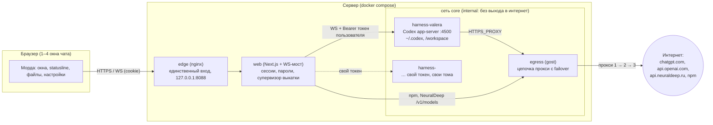

# Архитектура Paddock — схема связки

## Зачем так

Валера работает в iTerm: 4–5 вкладок, в каждой агент со своей задачей, внизу statusline
(модель, папка, контекст, кеш, лимиты), сбоку панель с сетью и действиями. Paddock переносит
это в браузер **простым** способом: никакого своего агентного движка — берём готовый харнесс
(Codex, дальше OpenCode, Hermes…) как есть, кладём каждому пользователю в свой контейнер
и даём одну веб-морду, которая повторяет привычную работу в терминале.

## Схема



ASCII-версия для терминала:

```
browser ──HTTPS/WS──▶ edge(nginx) ──▶ web(Next.js, WS-мост) ──WS+token──▶ harness-<user> (Codex app-server)
                                            │                                   │ HTTPS_PROXY
                                            └──────────────▶ egress(gost) ◀─────┘
                                                               │ proxy chain (failover)
                                                               ▼
                                                           интернет
```

## Что изолировано

| граница | как | проверено |
|---|---|---|
| харнесс ↔ интернет | сеть `core` `internal: true`, единственный выход — egress | запрос напрямую падает |
| харнесс ↔ LAN/хост/docker0 | egress не пускает приватные сети | curl на 192.168.x, хост — отказ |
| пользователь ↔ пользователь | свой контейнер, свои тома, свой capability-токен | ⬜ общая сеть `core`, см. roadmap 3.9 |
| браузер ↔ харнесс | токен только у морды, WS-мост проверяет cookie-сессию и Origin | 401 без cookie, 403 с чужого Origin |
| морда ↔ egress API | API gost только в `core` и с паролем, который знает морда | 401 из харнесса |
| контейнеры | `cap_drop: ALL`, `no-new-privileges`, лимиты памяти/CPU | compose |

## Где лежит состояние (всё переносимо томами — основа «мобильности»)

| том | что | кто пишет |
|---|---|---|
| `codex-home-<user>` | `~/.codex`: сессии, архив, config.toml, вход в ChatGPT, скиллы, инструменты Paddock (`paddock/tools/`) | харнесс, морда через его API |
| `workspace-<user>` | `/workspace`: проекты, картинки (`images/`), вложения (`.paddock/uploads/`) | харнесс |
| `web-data` | `auth.db`: пользователи и сессии морды | web |
| `web-builds` | текущая и прошлая сборки морды | супервизор |
| `secrets/` (каталог на хосте) | токены харнессов, `web.env`, `egress/gost.yaml` с паролями прокси | админ, морда (прокси через API gost) |

Переезд на другой сервер = скопировать `secrets/` и тома, `docker compose up`. Автоматизация — roadmap 3.8.

## Поток одного хода

1. Окно чата шлёт `turn/start` по WS → морда добавляет токен пользователя → харнесс.
2. Харнесс стримит события (`item/*`, `turn/*`, `thread/tokenUsage/updated`) → морда раздаёт их окнам по `threadId`.
3. Запрос разрешения от харнесса идёт в окно, где открыт его тред.
4. Обрыв связи: после переподключения окна перечитывают тред из истории, ничего не теряется.

Протокол между мордой и харнессами и план смены харнессов — [harness-protocol.md](harness-protocol.md).
