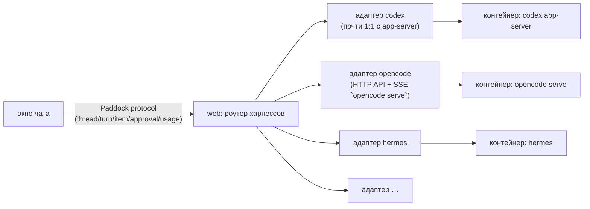

# Харнессы — протокол морды и адаптеры

**Харнесс** — готовый агентный движок (Codex, OpenCode, Hermes…), который ведёт сессии,
вызывает модель и инструменты. Paddock его не переписывает, а запускает в контейнере
пользователя и показывает в морде.

## Сейчас

Морда говорит с **Codex app-server** (JSON-RPC 2.0 по WebSocket) напрямую: `thread/*`,
`turn/*`, `item/*`, `model/list`, `account/*`, `config/*`, `fs/*`. Перевод событий в
сообщения — `web/lib/messages.ts`. Это быстрый путь, но он завязывает морду на Codex.

## Целевая схема: один протокол морды + адаптер на харнесс

**Paddock protocol** — минимальный общий набор, его и так уже использует морда:

| сущность | что нужно от харнесса |
|---|---|
| thread | создать в папке, продолжить, список, архив, имя |
| turn | старт с текстом/картинками, прерывание, откат до хода (правка сообщения) |
| item (поток) | текст ответа, рассуждения, shell (команда, вывод, код выхода), правка файлов (diff), MCP/инструмент, веб-поиск |
| approval | запрос разрешения → ответ разрешить / на сессию / отказать |
| usage | токены, окно контекста, лимиты аккаунта (если есть) |
| models | список моделей и усилий; провайдеры (ключи) |
| fs | прочитать файл/картинку, список папок, создать папку |
| skills/fs | список скиллов по папке, вкл/выкл; запись файлов — так ставятся инструменты Paddock (CLI + скилл) |

Адаптер живёт **в морде** (TypeScript) и переводит нативный протокол харнесса в этот набор.
Что харнесс не умеет, морда прячет (например, нет отката — нет кнопки «изменить»).

## Смена харнесса на лету

- У пользователя может быть несколько харнесс-контейнеров (`harness-<user>-codex`, `-opencode`…)
  с **общим** томом `workspace-<user>`: проекты и файлы одни, сессии у каждого свои.
- Харнесс выбирается **на чат** (как сейчас провайдер модели): в пикере появляется группа «Харнесс».
- Смена харнесса в открытом чате = новый чат в той же папке (контекст можно передать сводкой).
- Инструменты Paddock — это CLI + скилл, не MCP: shell есть у любого харнесса и любой модели. Морда ставит их во все харнессы пользователя одинаково.

## Кандидаты

| харнесс | как подключается | статус |
|---|---|---|
| Codex | `codex app-server --listen ws://…` (JSON-RPC) | ✅ работает |
| OpenCode | `opencode serve` — HTTP API + SSE, OpenAI-совместимые провайдеры (NeuralDeep сразу) | ⬜ проверить API на живом контейнере |
| Hermes | агент Nous Research; нужен проверенный способ headless-управления | ⬜ проверить |
| coddy | ❔ уточнить у Валеры, что имеется в виду | ❔ |
| PicoClaw | лёгкий агент, модели через litellm/NeuralDeep | ⬜ |

Порядок работ — roadmap 3.7: сначала вынести общий интерфейс из `pane.tsx`/`chat.tsx`
в `lib/harness/` (адаптер codex = текущий код), потом второй харнесс (OpenCode),
и только потом смена на лету.
